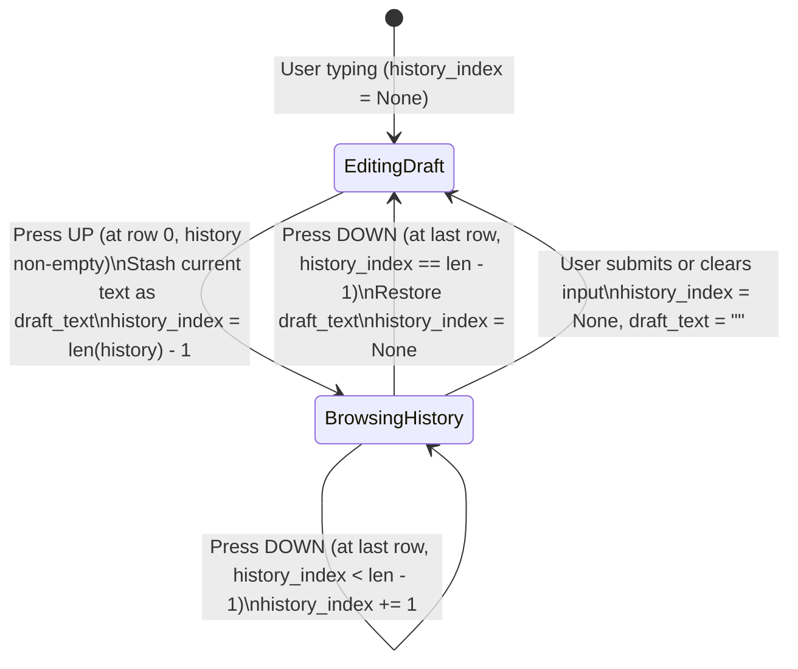

# Specification: Input History Navigation (Up/Down Arrow Prompt Recall)

## 1. Overview & Objectives

Enable shell-style prompt history navigation directly inside Raven's main `ChatInput` widget. Users can press the `Up` and `Down` arrow keys to cycle through their last 10 submitted queries, persisted globally across TUI restarts in `~/.raven/input_history.json`.

### Key Objectives
- **Global Persistence:** Store up to 10 recent user queries in `~/.raven/input_history.json` so prompt recall works seamlessly across sessions and application restarts.
- **Smart Filtering & Deduplication:** Record natural language queries and parameterized slash commands (e.g., `/explain`, `/plan`, `/debug`, `/ask`, `/review`, `/coach`, `/skill`, `/imagine`, `/image`), while ignoring pure UI modal toggles or lifecycle commands (`/model`, `/models`, `/sessions`, `/connect`, `/usage`, `/new`, `/exit`, `/quit`, `/skills`, `/checkpoints`, `/auto-approve`). Avoid consecutive duplicate entries.
- **Boundary-Aware Multi-line Navigation:** Respect multi-line editing in `ChatInput` (`TextArea`). Trigger `Up` history navigation only when the cursor is on the **first line** (`row == 0`), and `Down` history navigation only when the cursor is on the **last line** (`row == last_line_index`).
- **Draft Preservation:** When the user begins typing a new prompt and presses `Up` to inspect earlier history, temporarily stash the unsent draft and restore it when pressing `Down` past the most recent history entry.
- **Non-Interference with Active Overlays:** Yield priority to the slash-command `#autocomplete_list` dropdown and `#questionnaire_bar` when either is active.

---

## 2. User Experience & State Machine



### Cursor Positioning Upon Recall
- When navigating **Up** to an older entry, load the recalled text into `ChatInput` and place the cursor at the **end of the first line** (`row = 0, col = len(first_line)`) or **end of the text** so subsequent `Up` presses immediately trigger without requiring extra vertical cursor movement if the recalled prompt is single-line, or allow line-by-line traversal if multi-line.
  - *Refinement for multi-line history entries:* To prevent getting trapped when rapidly pressing `Up` through a multi-line historical prompt, if the text in `ChatInput` was just loaded via history navigation (unmodified by typing), pressing `Up` or `Down` cycles directly to the previous/next history entry. Once the user presses `Left`/`Right` or edits characters inside a recalled multi-line prompt, standard boundary-aware row checks (`row == 0` for `Up`, `row == last_row` for `Down`) apply.

---

## 3. Storage & Filtering Rules

### 3.1. Storage File (`~/.raven/input_history.json`)
- **Path:** `Path.home() / ".raven" / "input_history.json"`
- **Max Capacity:** `MAX_INPUT_HISTORY = 10` (ordered oldest to newest: `history[0]` is oldest, `history[-1]` is most recent).
- **Format:**
  ```json
  [
    "explain how the loop guard works",
    "/plan subagent architecture",
    "fix the bug in chat_input.py"
  ]
  ```

### 3.2. Filtering & Deduplication Rules
1. **Ignore Empty Inputs:** Whitespace-only strings are never recorded.
2. **Excluded UI/Modal Commands:** Do not record standalone modal/system commands:
   - `/exit`, `exit`, `quit`
   - `/sessions`, `/connect`, `/usage`, `/new`, `/fork`
   - `/model`, `/models`, `/skills`, `/checkpoints`, `/auto-approve`
   - Permission/Questionnaire inline responses (when `pending_permission` or `pending_questionnaire` is active).
3. **Included Commands & Queries:**
   - All natural language prompts.
   - Parameterized workflow commands: `/ask`, `/explain`, `/plan`, `/debug`, `/review`, `/coach`, `/report`, `/skill <name> ...`, `/imagine <prompt>`, `/image <path> ...`, `/paste-image ...`, `/compact ...`, `/checkpoint ...`, `/rollback ...`.
4. **Deduplication:**
   - If the newly submitted query already exists in history, remove its earlier occurrence before appending it to the end (MRU—Most Recently Used ordering), ensuring all 10 slots hold unique queries with the latest submission at `history[-1]`.
   - Enforce `history = history[-10:]` before writing to disk.

---

## 4. Component Architecture & Interfaces

### 4.1. Input History Helper (`agent/terminal_ui/chat_input.py` or `agent/core/session_manager.py`)
Encapsulate persistence and state inside `ChatInput` (or a dedicated lightweight `InputHistoryManager` helper in `agent/terminal_ui/chat_input.py`):

```python
MAX_INPUT_HISTORY = 10
EXCLUDED_HISTORY_PREFIXES = {
    "/exit", "exit", "quit",
    "/sessions", "/connect", "/usage", "/new", "/fork",
    "/model", "/models", "/skills", "/checkpoints", "/auto-approve",
}

def should_record_query(raw_query: str) -> bool:
    """Returns True if the submitted query should be stored in input history."""
```

### 4.2. `ChatInput` State & Key Handling (`agent/terminal_ui/chat_input.py`)
Add history state attributes to `ChatInput.__init__` / `on_mount`:
- `self.history: list[str]` — loaded from `~/.raven/input_history.json`.
- `self.history_index: int | None = None` — `None` when editing live draft; `0 .. len(self.history) - 1` when browsing history.
- `self._draft_text: str = ""` — stashes unsent input when transitioning from `history_index is None` to browsing.
- `self._navigating_history: bool = False` — tracks whether the current buffer was just populated by history recall (allowing seamless `Up`/`Down` across multi-line history items until manually edited or cursor-moved horizontally).

#### Key Interception Order in `ChatInput.on_key(event: events.Key)`:
1. **Newline Shortcuts (`Shift+Enter`, `Ctrl+J`, etc.):** Existing newline insertion logic.
2. **Slash Command Autocomplete Priority:**
   - Check if `#autocomplete_list` has `styles.display == "block"`. If visible, **do not** trigger history navigation on `up`/`down`; let the app/autocomplete handler move the option highlight.
3. **Questionnaire Bar Priority:**
   - Existing check: if `self.app.pending_questionnaire` and input is empty, `up`/`down`/`left`/`right` control `#questionnaire_bar`.
4. **History Navigation (`event.key == "up"`):**
   - Trigger condition: `self._navigating_history` is `True` OR `self.cursor_location[0] == 0`.
   - Call `self.navigate_history_up()`, move cursor to end of text, `event.prevent_default()`, `event.stop()`.
5. **History Navigation (`event.key == "down"`):**
   - Trigger condition: `self.history_index is not None` AND (`self._navigating_history` is `True` OR `self.cursor_location[0] == self.document.line_count - 1`).
   - Call `self.navigate_history_down()`, move cursor to end of text, `event.prevent_default()`, `event.stop()`.
6. **Reset `_navigating_history` on User Edits / Horizontal Moves:**
   - If the user presses `left`, `right`, or types characters while `self.history_index is not None`, set `self._navigating_history = False` so normal multi-line cursor movement engages.

### 4.3. Recording Submissions (`agent/terminal_ui/app.py`)
- In `RavenTUI.on_chat_input_submitted(self, event: ChatInput.Submitted)`:
  - Once `user_input` passes the initial guard checks (not `pending_permission`, not `pending_questionnaire`, not `is_generating`, not empty), invoke `input_widget.add_to_history(user_input)`.
  - `add_to_history(user_input)` validates via `should_record_query(user_input)`, deduplicates, trims to `MAX_INPUT_HISTORY = 10`, resets `history_index = None` and `_draft_text = ""`, and persists to `~/.raven/input_history.json`.

---

## 5. Edge Cases & Safeguards

1. **Corrupted or Missing `~/.raven/input_history.json`:**
   - Gracefully fallback to `[]` if the file does not exist, is empty, or contains invalid JSON/non-string items.
2. **Autocomplete Dropdown Interaction:**
   - If a recalled history item starts with `/` without spaces, `on_text_area_changed` in `app.py` might normally open `#autocomplete_list`, which would hijack subsequent `Up`/`Down` keys!
   - **Safeguard:** Suppress opening `#autocomplete_list` when `chat_input._navigating_history` is `True`, so recalling a `/command` in history doesn't trap the user's `Up`/`Down` arrow keys inside the slash command popup.
3. **Multi-line History Items:**
   - Keeping `self._navigating_history = True` immediately after recalling an item allows the user to press `Up` or `Down` repeatedly through multi-line prompts without getting stuck traversing line-by-line, while pressing `Left`/`Right` or typing switches into standard boundary-aware editing.

---

## 6. Implementation Steps

1. **Implement History Storage & State in `ChatInput` (`agent/terminal_ui/chat_input.py`):**
   - Add `load_history()`, `save_history()`, `add_to_history()`, `navigate_history_up()`, and `navigate_history_down()`.
   - Update `ChatInput.on_key()` to handle `up` and `down` keys with boundary awareness and overlay checks.
2. **Update Autocomplete & Submission Integration (`agent/terminal_ui/app.py`):**
   - Prevent `on_text_area_changed` from popping up `#autocomplete_list` during active history recall (`chat_input._navigating_history`).
   - Call `input_widget.add_to_history(user_input)` inside `on_chat_input_submitted`.
