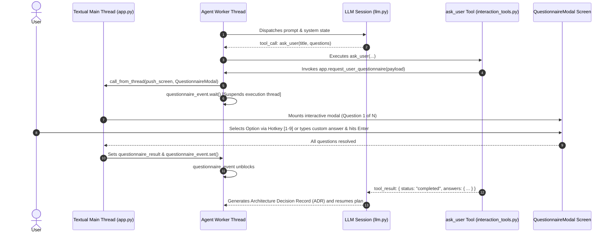

# Specification: Interactive Questionnaire Tool (`ask_user`) & TUI Modal

## 1. Executive Summary & Objective

In autonomous coding agents, decision-making frequently requires developer input for architectural forks, database selections, breaking changes, or scope trade-offs. Current implementations suffer from two failure modes:
1. **The Chat-Dump Failure:** The agent ends its tool turn and dumps 5 to 15 markdown questions into the main chat window. This terminates the agent loop, discards chain-of-thought scratchpad context, and forces the user to manually type out unstructured paragraphs to answer.
2. **The 1-by-1 Round-Trip Failure:** The agent asks single questions sequentially across individual LLM turns. This introduces extreme latency (2 to 4 seconds per question across 8 turns = 16 to 32 seconds of pure waiting) and compounds input token costs, as the entire conversation history is re-sent on every single turn.

This specification introduces a first-class **Interactive Questionnaire Tool (`ask_user`)** coupled with a dedicated Textual modal (`QuestionnaireModal`). It allows Raven to batch up to 3-4 frontier architectural questions into a single structured payload, pause the execution loop safely on a background thread, present a rapid keyboard-driven modal in the terminal, collect user decisions, and resume execution seamlessly within the same turn.

---

## 2. Architecture & Execution Pipeline



---

## 3. Tool Definition & Constrained Schema

The tool is declared in `agent/tools/tool_registry.py` under the name `ask_user`. It enforces constrained grammar decoding across OpenAI, OpenRouter, and Gemini backends.

### JSON Schema
```json
{
  "type": "function",
  "function": {
    "name": "ask_user",
    "description": "Presents a structured, interactive questionnaire modal to the user for architectural decisions, trade-offs, and critical scope confirmations. Do not dump questions into chat text when this tool is available. Batch up to 3 questions belonging to the active decision frontier.",
    "parameters": {
      "type": "object",
      "properties": {
        "title": {
          "type": "string",
          "description": "Short heading for the decision batch (e.g., 'Database & State Management Selection')."
        },
        "questions": {
          "type": "array",
          "description": "List of 1 to 4 structured decision items.",
          "items": {
            "type": "object",
            "properties": {
              "id": {
                "type": "string",
                "description": "Unique key identifier for the answer (e.g., 'db_engine', 'auth_strategy')."
              },
              "question": {
                "type": "string",
                "description": "Clear, concise formulation of the decision to be made."
              },
              "context": {
                "type": "string",
                "description": "Brief technical context, trade-offs, or system implications."
              },
              "options": {
                "type": "array",
                "items": { "type": "string" },
                "description": "2 to 4 concrete implementation options."
              },
              "recommended": {
                "type": "string",
                "description": "The exact recommended option from the list."
              }
            },
            "required": ["id", "question", "options", "recommended"]
          }
        }
      },
      "required": ["title", "questions"]
    }
  }
}
```

---

## 4. Defensive Payload Normalization

To ensure weaker or budget models never cause a crash or malformed UI state, the execution tool in `agent/tools/interaction_tools.py` defends against common LLM formatting defects:

1. **Option Coercion:** If `options` is supplied as a comma-separated string or newline string instead of a list, it is parsed into `list[str]`.
2. **Missing Recommended:** If `recommended` is omitted or does not match any option, it defaults to `options[0]`.
3. **Empty Options:** If no options are provided, defaults to `["1. Approve / Proceed", "2. Reject / Modify"]`.
4. **Sanitized IDs:** Missing IDs are auto-generated as `q_1`, `q_2`, etc.
5. **Batch Truncation:** Maximum of 4 questions per batch. Questions beyond index 3 are truncated with a warning in tool context to prevent questionnaire fatigue.

```python
def normalize_questionnaire_payload(raw_questions: list) -> list[dict]:
    normalized = []
    for idx, q in enumerate(raw_questions[:4]):
        opts = q.get("options", [])
        if isinstance(opts, str):
            opts = [o.strip() for o in opts.replace("\n", ",").split(",") if o.strip()]
        if not isinstance(opts, list) or not opts:
            opts = ["Approve / Proceed", "Reject / Modify"]
        
        opts = [str(o).strip() for o in opts if str(o).strip()]
        rec = str(q.get("recommended", "")).strip()
        if not rec or rec not in opts:
            rec = opts[0]

        normalized.append({
            "id": str(q.get("id") or f"decision_{idx + 1}").strip(),
            "question": str(q.get("question", "Decision required:")).strip(),
            "context": str(q.get("context", "")).strip(),
            "options": opts,
            "recommended": rec
        })
    return normalized
```

---

## 5. Thread Synchronization & Harness Integration

Raven executes LLM streaming and tool calls on a background `worker` thread inside `RavenApp` (`agent/terminal_ui/app.py`). UI operations (modals, widgets) run strictly on Textual's async main thread.

### Thread Model
1. **Thread Communication Primitive:**
   ```python
   self.questionnaire_event = threading.Event()
   self.questionnaire_result: dict | None = None
   ```
2. **Dispatch Method (`app.py`):**
   ```python
   def request_user_questionnaire(self, title: str, questions: list[dict]) -> dict:
       self.questionnaire_event.clear()
       self.questionnaire_result = None
       
       self.call_from_thread(self._open_questionnaire_modal, title, questions)
       self.questionnaire_event.wait()
       
       if self.cancel_event.is_set() or self.questionnaire_result is None:
           return {"status": "cancelled", "answers": {}}
           
       return {"status": "completed", "answers": self.questionnaire_result}
   ```
3. **Cancellation Handling:**
   If the user hits `Ctrl+C` or exits during the modal, `self.cancel_event.set()` unblocks the event immediately and cancels the tool turn.

---

## 6. Textual Modal Component (`QuestionnaireModal`)

Located in `agent/terminal_ui/questionnaire_modal.py` with styles in `agent/terminal_ui/styles/questionnaire_modal.tcss`.

### Visual Structure
- **Container Dimensions:** Fixed width `78`, auto height with padding, centered viewport.
- **Palette:** Strict compliance with Raven palette (`#1e1e1e` background, `#2d2d2d` card background, cyan `#00ffff` / green `#00ff88` accents). Strictly no emojis.
- **Header:** Title + step counter indicator (`[Question 1 of 3]`).
- **Context Card:** Renders technical context in dim grey text.
- **Options List:** Radio/Select cards with keyboard badges:
  - `[1] Option One`
  - `[2] Option Two [RECOMMENDED]` (Highlighted with cyan accent border)
  - `[3] Custom Input`
- **Navigation & Hotkeys:**
  - Pressing `1` through `9`: Directly selects that option.
  - `Up` / `Down` arrows: Cycles options.
  - `Enter`: Accepts the currently focused/recommended option and advances to the next question.
  - `Tab`: Moves focus between options and the custom text input.
  - `Escape`: Cancels the questionnaire.
- When the final question is answered, the modal closes and resolves the promise.

---

## 7. Skill Integration (`grill-me`)

Update `~/.raven/skills/grill-me/SKILL.md` to mandate the use of `ask_user`:

1. **Autonomous Research First:** The agent must inspect repo files and configs before calling `ask_user`. Never ask questions that can be discovered on disk.
2. **Frontier Batching:** Group related architectural choices that share the same decision layer (e.g., ORM + Database engine) into a single call with 2 to 3 questions.
3. **Mandatory Recommendations:** Every question in the batch must have a concrete, justified recommendation.
4. **Code Freeze:** Raven is strictly prohibited from writing or editing codebase files while questions remain unresolved.

---

## 8. Implementation Roadmap

| Phase | Tasks | Target Files |
| :--- | :--- | :--- |
| **Phase 1: Tool Registry & Normalizer** | Define JSON schema for `ask_user`, implement payload normalization, register in `TOOLS` | `agent/tools/interaction_tools.py`, `agent/tools/tool_registry.py` |
| **Phase 2: Textual Modal UI** | Implement `QuestionnaireModal`, hotkey bindings, radio options, styling without emojis | `agent/terminal_ui/questionnaire_modal.py`, `agent/terminal_ui/styles/questionnaire_modal.tcss` |
| **Phase 3: App Thread Synchronization** | Implement `request_user_questionnaire`, event lifecycle, worker bridge in `RavenApp` | `agent/terminal_ui/app.py` |
| **Phase 4: Skill Behavioral Prompting** | Update `grill-me` skill definition to enforce batch questionnaire tool calls | `~/.raven/skills/grill-me/SKILL.md` |

---

## 9. Architectural Evolution: In-Stream `QuestionnaireBar`

Rather than floating a centered modal popup over the chat stream (`QuestionnaireModal`), the UI was evolved into an attached, in-stream action container (`QuestionnaireBar` in `agent/terminal_ui/questionnaire_bar.py` styled in `agent/terminal_ui/styles/app.tcss`).

Key structural traits:
- **Mount Target:** Sits directly inside `#bottom_bar` immediately above `#chat_input` (matching the confirmation/permission bar pattern).
- **Full Horizontal Spread:** Distributes decision options across a horizontal grid (`OptionCardWidget`), rendering cards side-by-side with hotkey badges, titles, descriptions, and recommended pill indicators.
- **In-Place Step Progression:** When an option is selected or custom text is submitted, the active question refreshes in-place without container unmounts or screen flicker.
- **Input Isolation:** The standard `ChatInput` is cleanly hidden while the questionnaire is active and restored upon completion or cancellation.
