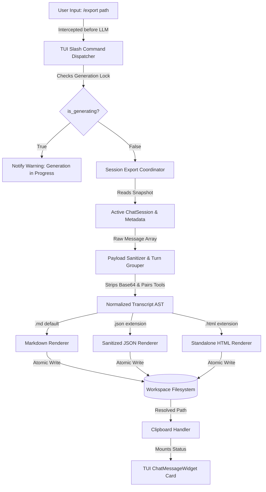

# RFC: Session Transcript Export Engine (`/export`)

## 1. Executive Summary & Problem Statement
Currently, conversation sessions in the CLI agent are persisted solely as raw internal JSON state payloads containing verbose system prompts, unformatted tool call JSON strings, and multi-megabyte inline Base64 data URIs from multimodal inputs. Users lack a built-in mechanism to extract, share, or archive a clean, human-readable conversation transcript for pull requests, technical documentation, post-mortem reviews, or external evaluation pipelines. This specification defines the architecture for the `/export [optional_path]` slash command—an OpenCode-inspired deterministic session exporter that serializes the active conversation into sanitized Markdown (`.md`) by default, or structured `.json` and standalone `.html` formats based on the target file extension, writes the artifact to the workspace, copies the resolved file path to the system clipboard, and renders an in-chat confirmation card.

---

## 2. Goals & Explicit Non-Goals

### Goals
- **Deterministic Multi-Format Serialization:** Support zero-argument `/export` (defaulting to a slugified Markdown file in the active workspace) and `/export <path>` with automatic format routing based on extension (`.md`, `.json`, `.html`).
- **Multimodal & Payload Sanitization:** Strip inline Base64 data URIs (`data:image/...;base64,...`) and replace them with compact metadata placeholders (`[Attached Image: image/png, ~142.5 KB]`), guaranteeing export file sizes remain under 500 KB even for image-heavy sessions.
- **Structured Tool Execution Folding:** Group consecutive `assistant` tool-call dispatches and `tool` execution responses into collapsible `<details><summary>` blocks in Markdown and HTML outputs so high-level conversation flow remains scannable without losing debugging provenance.
- **Zero-Latency Execution & Clipboard Integration:** Complete serialization and atomic disk writes in `O(message_count)` time (under 50 ms for 200-turn sessions), automatically copy the absolute output file path to the OS clipboard, and display an in-chat status card without triggering an LLM round-trip.

### Explicit Non-Goals
- **Cloud Gist / Remote Hosting Upload:** Unlike OpenCode's optional `--share` cloud upload, this iteration strictly targets local filesystem persistence and clipboard integration with zero external network calls.
- **Importing / Hydrating Markdown Transcripts:** Exported `.md` and `.html` artifacts are one-way presentation outputs; session restoration continues to rely on native internal session storage or `/fork`.
- **PDF Rendering Engine:** Native PDF generation requires heavy native layout engines and is out of scope for the core `/export` command.

---

## 3. Architecture Topology & Data Flow

When the user submits `/export [optional_path]` in the TUI input bar:
1. **Command Interception:** The TUI input dispatcher intercepts `/export` prior to LLM stream initialization. If an LLM generation worker is currently active (`is_generating == True`), the command is rejected with a warning notification to prevent exporting torn mid-stream state.
2. **State Snapshot & Metadata Extraction:** The Export Engine reads the in-memory message buffer and session metadata (Session ID, Title, Active Model, Project Name, Created/Updated timestamps, Token Usage, and Cumulative Cost).
3. **AST Normalization & Sanitization Pass:**
   - System prompt injection messages (`role == "system"`) are excluded from user-facing transcripts unless explicitly requested in JSON export mode.
   - Multimodal `user` content arrays are scanned; Base64 `image_url` payloads are hashed/measured and replaced with compact descriptor tokens.
   - Interleaved `assistant` (`tool_calls`) and `tool` (`tool_call_id`) messages are paired into cohesive `ToolInvocationRecord` nodes.
4. **Format Renderer Dispatch:**
   - `.md` (Default): Renders YAML frontmatter, session summary table, chronological User/Assistant turns, and GitHub-flavored Markdown `<details>` blocks for tool traces.
   - `.json`: Serializes a sanitized, schema-versioned JSON envelope suitable for eval harnesses and programmatic replay.
   - `.html`: Renders a self-contained, dark-mode-styled HTML document with interactive collapsible tool drawers and syntax-highlighted code blocks.
5. **Atomic Persistence & Clipboard Copy:** Writes to `<target_path>.tmp` and atomically replaces `<target_path>`. Invokes OS clipboard binding (`pyperclip` / native Windows `clip` fallback) with the resolved path and mounts a confirmation card in the TUI chat history.



---

## 4. Persistence & Data Models

### 4.1 Normalized Transcript AST (`TypedDict` Contracts)

```python
from typing import TypedDict, List, Optional, Literal, Dict, Any

ExportFormat = Literal["md", "json", "html"]

class SanitizedAttachment(TypedDict):
    media_type: str          # e.g., "image/png"
    approx_bytes: int        # Decoded byte size estimate: (len(b64_str) * 3) // 4
    sha256_prefix: str       # First 12 hex chars of SHA-256 for deduplication/verification

class ToolExecutionTrace(TypedDict):
    call_id: str             # OpenAI tool_call_id
    tool_name: str           # Registered function name (e.g., "patch_file")
    display_label: str       # Human-friendly header (e.g., "Update: agent/main.py")
    arguments: Dict[str, Any]
    result_content: str      # Truncated at 10,000 chars in .md/.html with "[...truncated]" footer
    is_error: bool

class TranscriptTurn(TypedDict):
    turn_index: int
    role: Literal["user", "assistant"]
    model_name: Optional[str]
    timestamp: Optional[str]
    text_content: str
    attachments: List[SanitizedAttachment]
    tool_traces: List[ToolExecutionTrace]

class SessionExportEnvelope(TypedDict):
    schema_version: Literal["1.0"]
    session_id: str
    parent_session_id: Optional[str]
    title: str
    project_name: str
    model_name: str
    created_at: str          # ISO-8601 UTC
    exported_at: str         # ISO-8601 UTC
    metrics: Dict[str, Any]  # prompt_tokens, completion_tokens, total_tokens, session_cost_usd, turn_count
    turns: List[TranscriptTurn]
```

### 4.2 Markdown Output Layout Specification (`.md`)

```markdown
---
session_id: "a1b2c3d4"
title: "Refactor Session Exporter"
project: "my-cli-agent"
model: "claude-3-7-sonnet"
created_at: "2025-05-12T14:20:00Z"
exported_at: "2025-05-12T14:45:10Z"
total_tokens: 18420
cost_usd: 0.0412
---

# Refactor Session Exporter

| Metric | Value |
| :--- | :--- |
| **Session ID** | `a1b2c3d4` |
| **Project** | `my-cli-agent` |
| **Model** | `claude-3-7-sonnet` |
| **Turns** | 4 |
| **Total Tokens** | 18,420 (15,100 prompt / 3,320 completion) |
| **Estimated Cost** | $0.0412 |

---

## User

[Attached Image: image/png, ~148.2 KB, sha256:9f86d081884c]

Want to add `/export` chat command like in opencode.

---

## Assistant (`claude-3-7-sonnet`)

I will inspect the slash command registry and session manager first.

<details>
<summary>Tool Call: <code>read_file</code> (agent/terminal_ui/slash_commands.py)</summary>

**Arguments:**
```json
{
  "file_path": "agent/terminal_ui/slash_commands.py",
  "start_line": 1,
  "line_count": 100
}
```

**Output:**
```text
1 | """
2 | Slash commands registry and associated prompt templates...
```
</details>

Here is the architectural plan for the `/export` command...
```

---

## 5. Interface & Communication Contracts

### 5.1 Slash Command Registration Contract
Registered in the central `SLASH_COMMANDS` dictionary:
- **Command Key:** `"/export"`
- **Placeholder:** `"/export [file_path.md | .json | .html]"`
- **Description:** `"Export current chat session transcript to Markdown, JSON, or HTML"`
- **System Prompt:** `""` (Handled deterministically on the client thread; never forwarded to the LLM).

### 5.2 CLI Argument Resolution & Path Routing Rules

| Invocation Pattern | Resolved Output Path | Target Format |
| :--- | :--- | :--- |
| `/export` | `<workspace_cwd>/raven-session-<session_id>-<slug_title>.md` | `md` |
| `/export notes.md` | `<workspace_cwd>/notes.md` | `md` |
| `/export ./docs/audit.json` | `<workspace_cwd>/docs/audit.json` | `json` |
| `/export C:/temp/chat.html` | `C:/temp/chat.html` | `html` |
| `/export ./exports/` (directory path) | `<workspace_cwd>/exports/raven-session-<session_id>-<slug_title>.md` | `md` |
| `/export custom_name` (no extension) | `<workspace_cwd>/custom_name.md` | `md` |

**Filename Slugification Invariant:**
- Session title is lowercased, non-alphanumeric characters are replaced with `-`, consecutive hyphens are collapsed, and the slug is capped at 40 characters (fallback: `untitled`).

### 5.3 Internal Module API Signature

```python
def export_active_session(
    session_data: Dict[str, Any],
    raw_path_arg: str = "",
    workspace_dir: Optional[Path] = None,
    max_tool_output_chars: int = 10_000,
) -> Dict[str, Any]:
    """
    Serializes and writes the active session transcript atomically to disk.

    Returns:
        {
            "success": bool,
            "output_path": str,          # Absolute resolved path
            "format": "md" | "json" | "html",
            "bytes_written": int,
            "turn_count": int,
            "clipboard_copied": bool,
            "error": Optional[str]
        }
    """
```

---

## 6. Failure Modes, Security, & Resilience

| Failure Scenario | Detection Mechanism | Mitigation & Recovery Behavior |
| :--- | :--- | :--- |
| **Empty Session Export** | Zero non-system messages in active `chat_session.messages` | Abort disk write; trigger TUI toast notification (`severity="warning"`, `"Cannot export an empty conversation."`). |
| **Mid-Stream Race Condition** | User runs `/export` while `self.is_generating == True` | Block execution before reading message buffer; notify user to wait or cancel active generation (`Escape`) first. |
| **Unpaired / Orphaned Tool Calls** | Interrupted generation left an `assistant` `tool_calls` entry without a matching `tool` response | Pair via `tool_call_id` lookup map; if response is missing, set `result_content = "[Interrupted / No tool output recorded]"` and `is_error = True` rather than raising `KeyError`. |
| **Nested `<details>` or Fence Breakout in Tool Output** | Tool output contains raw ```` ``` ```` or `</details>` tags (e.g., reading a Markdown file) | Dynamically calculate backtick fence length (`max_backticks + 1`, minimum 4 ```` ```` ````) and HTML-escape raw `</details>` tags inside tool output blocks. |
| **Path Traversal / Invalid OS Filename** | User passes illegal Windows path characters (`<>:"|?*`) or non-existent parent directories | Validate path via `Path.resolve()`; create parent directories (`mkdir(parents=True, exist_ok=True)`) if within workspace or user home; catch `OSError`/`PermissionError` and render an in-chat error card without crashing the TUI. |
| **Clipboard Subsystem Unavailable** | Headless terminal session or clipboard lock contention on Windows | Wrap clipboard copy (`app.copy_to_clipboard` + OS `clip` subprocess fallback) in a non-blocking `try/except`; still succeed on file write and note clipboard status in the confirmation card. |

---

## 7. Implementation & Rollout Plan

1. **Phase 1: Core Export Engine**
   - Implement AST normalization, Base64 image stripping, orphan-safe tool pairing, dynamic backtick fencing, and `.md`, `.json`, and `.html` format renderers.
   - Implement atomic file persistence (`.tmp` write + `Path.replace`) and cross-platform clipboard path copying.
2. **Phase 2: Slash Command Registry & Autocomplete Wiring**
   - Add `/export` metadata to `SLASH_COMMANDS` so the TUI autocomplete dropdown surfaces `/export [file_path.md | .json | .html]` when typing `/ex`.
3. **Phase 3: TUI Event Handler Integration**
   - Intercept `/export` in the TUI submit handler, execute `export_active_session`, mount the formatted confirmation card showing file path, format, size, and clipboard status, and trigger a TUI toast notification.
