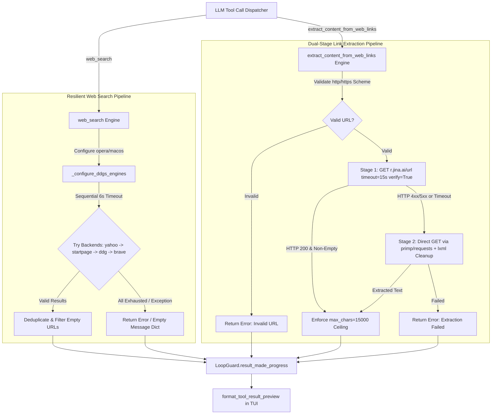

# RFC: Web Search & Content Extraction Resilience Specification

## 1. Executive Summary & Problem Statement
The web research subsystem (`web_search` and `extract_content_from_web_links`) currently suffers from five architectural and reliability defects across the execution pipeline:
1. **Unbounded Socket Hangs & Disabled TLS in Link Extraction (`P0`):** `extract_content_from_web_links` executes `requests.get(f"https://r.jina.ai/{web_link}", verify=False)` with no socket timeout, no HTTP status validation, no URL scheme validation, and disabled SSL verification. A stalled remote endpoint freezes the TUI worker thread indefinitely, while `verify=False` exposes traffic to MITM interception and emits `InsecureRequestWarning` to `stderr`.
2. **Unbounded Context Window Overflow (`P0`):** `extract_content_from_web_links` returns raw `response.text` without character or token truncation. Large documentation pages or repositories routinely return 50,000 to 300,000+ characters (15k–80k tokens) in a single tool call. Because `prune_message_payload` only stubs tool outputs older than `retention_turns=2` user turns, extracting 2–3 URLs within a single turn exhausts the model context window mid-loop.
3. **Single Point of Failure on `r.jina.ai` (`P1`):** When `r.jina.ai` rate-limits (`HTTP 429`), blocks a domain (`HTTP 403`), or returns `5xx`, link extraction either returns raw error HTML as valid content or fails completely without falling back to direct HTTP retrieval and local HTML-to-text extraction.
4. **LoopGuard Blindness to List-Wrapped Tool Errors (`P1`):** `web_search` returns `[{"error": "Failed to execute web search: ..."}]` on failure. `LoopGuard.result_made_progress` only checks `isinstance(result, dict)` or whether `str(result).lower()` starts with `("error", "failed", "failure")`. Because `"[{'error': ...}]"` starts with `"[{'error'"`, `LoopGuard` misclassifies every failed `web_search` call as forward progress, defeating `max_no_progress_rounds`.
5. **High Worst-Case Fallback Latency & Unformatted TUI Previews (`P1/P2`):** `web_search` sequentially iterates 4 backends (`yahoo`, `startpage`, `duckduckgo`, `brave`) with a `15s` timeout each (up to `60s` blocking latency on dead networks). Furthermore, `format_tool_result_preview` has no dedicated formatter for `web_search` or `extract_content_from_web_links`, rendering single-line truncated Python dictionary representations in the TUI without expandable result lists or error highlighting.

---

## 2. Goals & Explicit Non-Goals

### Goals
- **Deterministic Desktop Impersonation & Fast Failover in `web_search`:** Maintain deterministic `primp.Client(impersonate="opera", impersonate_os="macos")` injection across `("yahoo", "startpage", "duckduckgo", "brave")` while reducing per-backend timeout to `6s` (capping worst-case multi-backend failover latency to under `24s`).
- **Secure, Bounded, Dual-Stage Content Extraction:** Enforce strict `http://` and `https://` URL validation, enable TLS verification (`verify=True`), enforce a `15s` request timeout, automatically fall back to direct fetch + local HTML parsing (`lxml`) when `r.jina.ai` fails or rate-limits, and cap output payload size to `max_chars=15000` by default.
- **Accurate LoopGuard Progress Detection:** Teach `LoopGuard.result_made_progress` to recognize list-wrapped error dictionaries (`[{"error": ...}]`) and string error prefixes from extraction tools so repeated network failures trip `max_no_progress_rounds` predictably.
- **Structured TUI Timeline Previews:** Add dedicated `format_web_search_result` and `format_extract_link_result` formatters in `chat_message.py` with collapsible result rows, domain/character summaries, and red error badges.

### Explicit Non-Goals
- **Headless Browser / Playwright Rendering:** Adding Chromium/Playwright dependencies for client-side SPA hydration is out of scope to keep the CLI package lightweight.
- **Paid Search API Keys:** `web_search` remains zero-config and free without requiring external API keys (Tavily, Serper, Brave API).

---

## 3. Architecture Topology & Data Flow



---

## 4. Component Specifications & Contracts

### 4.1 `web_search` (`agent/tools/web_tools.py`)
- **Signature:**
  ```python
  def web_search(query: str, max_results: int = 5) -> List[Dict[str, Any]]:
  ```
- **Timeout & Failover Policy:**
  - `BACKENDS = ("yahoo", "startpage", "duckduckgo", "brave")`
  - `PER_BACKEND_TIMEOUT = 6` seconds.
- **Result Sanitization & Deduplication:**
  - Skip any raw result item missing both `title` and `href`/`link`.
  - Deduplicate results by normalized `url` while preserving rank order.
  - Ensure `results` is only accepted if at least one item has a non-empty `url` and (`title` or `snippet`).

### 4.2 `extract_content_from_web_links` (`agent/tools/web_tools.py`)
- **Signature:**
  ```python
  def extract_content_from_web_links(web_link: str, max_chars: int = 15000) -> str:
  ```
- **Validation & Security:**
  - Strip whitespace; validate via `urllib.parse.urlparse` that `scheme in ("http", "https")` and `netloc` is non-empty. If invalid, return `"Error: Invalid URL provided. Only http:// and https:// URLs are supported."`.
  - Clamp `max_chars` between `1,000` and `50,000` (default `15,000`, approx. 3,750 tokens).
- **Dual-Stage Retrieval:**
  1. **Stage 1 (Jina Reader Markdown API):**
     - `requests.get(f"https://r.jina.ai/{cleaned_url}", headers={"Accept": "text/plain", "User-Agent": "Mozilla/5.0 ..."}, timeout=15, verify=True)`
     - If `response.status_code == 200` and `response.text.strip()` is non-empty (and does not start with Jina rate-limit/error banners), use `response.text.strip()`.
  2. **Stage 2 (Direct Fetch + Local HTML-to-Text Fallback):**
     - Triggered automatically if Stage 1 raises a network/timeout exception or returns non-200 status (e.g., `429`, `403`, `502`, `503`).
     - Fetches `cleaned_url` directly with `timeout=10, verify=True` (using `primp.Client(impersonate="opera", impersonate_os="macos")` if available, falling back to `requests.get`).
     - Parses HTML via `lxml.html` (already installed in `.venv` via `ddgs`), strips `<script>`, `<style>`, `<noscript>`, `<svg>`, `<nav>`, `<footer>`, and `<header>` tags, and extracts clean paragraph/heading/code text.
- **Payload Truncation Guard:**
  - If `len(content) > max_chars`, slice `content[:max_chars]` and append:
    `f"\n\n... [Content truncated at {max_chars:,} characters ({len(content) - max_chars:,} characters omitted to protect context window)]"`
- **Error Contract:**
  - All failure returns MUST start with `"Error: Failed to extract content from ..."` so `LoopGuard.result_made_progress` and TUI formatters deterministically classify them as errors.

### 4.3 `LoopGuard.result_made_progress` (`agent/core/loop_guard.py`)
- **Enhanced Error Detection:**
  ```python
  @staticmethod
  def result_made_progress(result: Any) -> bool:
      if isinstance(result, dict):
          if result.get("success") is False or "error" in result:
              return False
      if isinstance(result, list) and result:
          if all(isinstance(item, dict) and "error" in item for item in result):
              return False
      normalized = str(result).strip().lower()
      return not normalized.startswith(("error", "failed", "failure", "no web link provided"))
  ```

### 4.4 TUI Timeline Formatters (`agent/terminal_ui/chat_message.py`)
- **`format_web_search_result(query: str, result: Any, expanded: bool = False) -> Text`:**
  - Handles both `list[dict]` (live execution) and JSON-encoded string (rehydrated session history).
  - If result contains `{"error": ...}`, renders `   |_ <error message>` in `bold red`.
  - If result contains `{"message": "No web search results..."}`, renders in `dim yellow`.
  - Otherwise displays `   |_ Found N web result(s)` in `bold green`:
    - **Collapsed:** Shows top 2 results (`1. Title — domain`) + `▶ ... [N more results - click to expand]`.
    - **Expanded:** Shows all results with numbered titles (`bold white`), URLs (`dim cyan`), and snippets (`dim white`) + `▼ [Click to collapse]`.
- **`format_extract_link_result(web_link: str, result_str: str, expanded: bool = False) -> Text`:**
  - If `result_str` starts with `"Error:"` or `"No web link"`, renders in `bold red`.
  - Otherwise displays `   |_ Extracted X,XXX chars (Y lines) from <domain>` in `bold green` with collapsible preview lines (`MAX_RESULT_LINES` collapsed, up to 40 lines expanded).

### 4.5 Tool Schema Update (`agent/tools/tool_registry.py`)
- Add missing `description` to `web_link` property in `extract_content_from_web_links`.
- Expose optional `max_chars` integer property (`description`: `"Maximum characters to return (1000 to 50000). Defaults to 15000."`).

---

## 5. Edge Cases & Failure Modes

| Scenario | Expected System Behavior |
| :--- | :--- |
| Empty or whitespace-only `web_link` or `file:///etc/passwd` | Immediately rejected by URL validator before any socket connection; returns `"Error: Invalid URL..."`. |
| `r.jina.ai` returns `HTTP 429` or times out after 15s | Automatically falls back to Stage 2 direct fetch + `lxml` local text extraction without failing the tool call. |
| Target webpage is a 250 KB API reference doc | Extracted text is cleanly truncated at `15,000` characters with an explicit omission footer, preventing context window overflow. |
| User is offline / DNS is unreachable during `web_search` | Fails across all 4 backends in at most `24s` (down from `60s`), returns `[{"error": ...}]`, and `LoopGuard.result_made_progress` records `False` so the agent does not loop infinitely. |
| Session is reloaded from disk (`/sessions`) | `format_web_search_result` parses JSON-serialized string payloads or live `list[dict]` identically so historical sessions render clean expandable search cards. |
